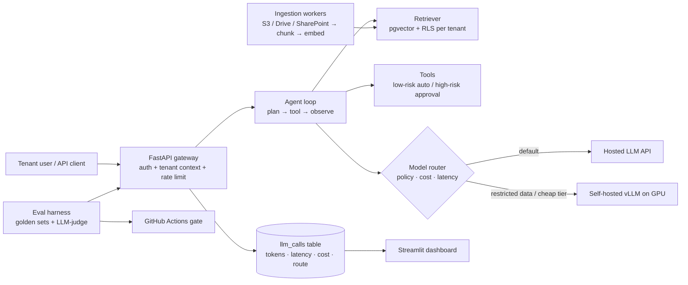

# Agentic RAG SaaS — multi-tenant enterprise AI platform with built-in evals

Production-style reference implementation of a **multi-tenant knowledge + workflow agent platform**:
tenant-isolated RAG, tool-using agents with human approval, **hybrid inference routing**
(hosted LLM API ↔ self-hosted vLLM on GPU), and an **evals + cost/latency dashboard** gated in CI.

> Built by Divith Raju — AI Engineer / Team Lead, 9.5 yrs data engineering, HPC/GPU platforms.

## Why this project
| Hiring signal | Where it shows up |
|---|---|
| Production RAG (not a demo) | `backend/app/rag.py`, `db/schema.sql` (pgvector + Row-Level Security) |
| Agents with guardrails | `backend/app/agent.py` (risk-tiered tools, human approval) |
| Evals as a first-class citizen | `evals/`, CI gate in `.github/workflows/ci.yml` |
| Cost / latency engineering | `backend/app/router.py`, `docs/COST_MODEL.md` |
| GPU / on-prem + cloud hybrid | `docker-compose.gpu.yml`, `infra/terraform` |
| Architecture & leadership | `docs/ARCHITECTURE.md`, `docs/adr/` |

## Architecture


## Quick start
```bash
cp .env.example .env            # add ANTHROPIC_API_KEY (and optionally SELF_HOSTED_URL)
docker compose up --build       # postgres(pgvector), redis, api, dashboard
# API:        http://localhost:8000/docs
# Dashboard:  http://localhost:8501
make seed                       # create demo tenants + sample docs
make eval                       # run golden-set evals, writes evals/results/latest.json
```
GPU / self-hosted model: `docker compose -f docker-compose.yml -f docker-compose.gpu.yml up`.

## Eval results (fill in as you iterate)
| Version | Retrieval hit@5 | Groundedness | Avg latency | Cost / 1k queries |
|---|---|---|---|---|
| v1 naive chunks | – | – | – | – |
| v2 + hybrid search + rerank | – | – | – | – |
| v3 + router (self-hosted for restricted) | – | – | – | – |

## Repo layout
```
backend/   FastAPI app: auth, ingestion, rag, agent, router, llm clients, metrics
db/        schema.sql — pgvector tables, Row-Level Security policies
evals/     golden datasets, runner, thresholds (CI fails on regression)
dashboard/ Streamlit quality + cost dashboard
infra/     Terraform (AWS) + notes for on-prem Kubernetes
docs/      architecture, roadmap, cost model, ADRs
```
See `docs/ROADMAP.md` for the 6-week build plan and `docs/adr/` for design decisions.

## License
MIT
