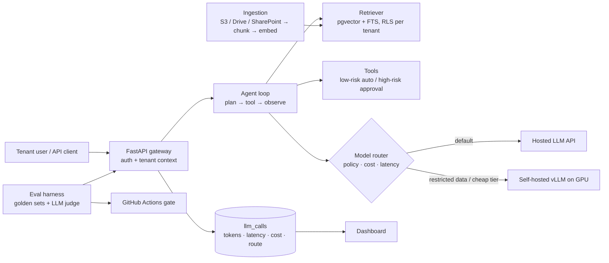

<div align="center">

# Agentic RAG SaaS

**Multi-tenant enterprise AI platform with agentic RAG, hybrid LLM routing, and CI-gated evals**

[](LICENSE)


### 👉 [**Open the Live Dashboard**](https://divithraju.github.io/Agentic-Rag-Saas/) 👈
*Quality, latency and cost dashboard (hosted on GitHub Pages, demo data)*

</div>

---

## Author

**Divith Raju** — AI Engineer Team Lead
9.5 years in data engineering · HPC/GPU platforms · LinkedIn Top Voice in Data Engineering
Open-source: [`friendlyetl`](https://pypi.org/project/friendlyetl/) (Python ETL framework on PyPI)
GitHub: [@divithraju](https://github.com/divithraju)

> Built to demonstrate production-grade AI engineering: tenant-safe RAG, guarded agents, hybrid cloud/on-prem inference, and measurable quality.

---

## Table of contents
1. [Overview](#overview)
2. [Live dashboard](#live-dashboard)
3. [Key features](#key-features)
4. [Architecture](#architecture)
5. [Tech stack](#tech-stack)
6. [Repository layout](#repository-layout)
7. [Quick start](#quick-start)
8. [API usage](#api-usage)
9. [Evaluation](#evaluation)
10. [Hybrid inference routing and cost](#hybrid-inference-routing-and-cost)
11. [Security and multi-tenancy](#security-and-multi-tenancy)
12. [Project status and roadmap](#project-status-and-roadmap)
13. [License](#license)

## Overview

Companies want AI assistants over their own documents, but a demo chatbot isn't enough. They need **tenant isolation, controlled actions, predictable cost, data-residency compliance, and proof that answers are correct.**

This project is a reference implementation of a **multi-tenant knowledge and workflow agent platform** that addresses these concerns:

- Each tenant's documents are isolated **in the database** (Postgres Row-Level Security).
- Answers come from **hybrid retrieval** (vector + keyword search) and are cited.
- An **agent** can use tools, but irreversible actions wait for **human approval**.
- A **router** decides per request whether to use a hosted LLM API or a **self-hosted model on GPU**, based on data sensitivity, cost tier and task.
- Every call is logged (tokens, latency, cost, route), and an **eval harness** blocks quality regressions in CI.

## Live dashboard

**[https://divithraju.github.io/Agentic-Rag-Saas/](https://divithraju.github.io/Agentic-Rag-Saas/)**

Shows requests, total cost, p95 latency, self-hosted share, cost and latency per day by route, routing decisions, and eval history, with a tenant filter.

> The hosted page is a **static preview using simulated data** (GitHub Pages cannot run a backend). The real dashboard is in [`dashboard/`](dashboard/) (Streamlit) and reads the live `llm_calls` table when you run the stack locally (`http://localhost:8501`).

## Key features

| Area | What it does |
|---|---|
| **Tenant-safe RAG** | pgvector (HNSW) + Postgres full-text search fused with Reciprocal Rank Fusion; every query is scoped by RLS |
| **Agent with guardrails** | JSON action loop; tools tagged low/high risk; high-risk actions go to an approval queue |
| **Hybrid inference** | Router sends restricted data / on-prem tenants to self-hosted vLLM, simple cheap-tier tasks to GPU, the rest to a hosted API |
| **Observability** | `llm_calls` table with tokens, latency, cost, model, route and reason; Streamlit dashboard |
| **Evals as a gate** | Golden datasets, retrieval hit@k, answer checks, LLM-as-judge groundedness; CI fails on regression |
| **Deployable anywhere** | Docker Compose locally, GPU override for vLLM, Terraform skeleton for AWS, on-prem notes (k3s + shared storage) |

## Architecture



Details: [`docs/ARCHITECTURE.md`](docs/ARCHITECTURE.md) · Decisions: [`docs/adr/`](docs/adr/)

## Tech stack

Python 3.12 · FastAPI · PostgreSQL 16 + pgvector · Redis · vLLM (OpenAI-compatible) · Anthropic Messages API · Streamlit · Docker Compose · Terraform (AWS) · GitHub Actions

## Repository layout

```
backend/     FastAPI app: auth, ingestion, rag, agent, router, LLM clients, metrics
db/          schema.sql: pgvector tables + Row-Level Security policies
evals/       golden datasets, eval runner, quality thresholds
dashboard/   Streamlit dashboard (live data)
docs/        architecture, roadmap, cost model, ADRs, and index.html (hosted dashboard preview)
infra/       Terraform (AWS) skeleton
.github/     CI workflow
```

## Quick start

```bash
git clone https://github.com/divithraju/Agentic-Rag-Saas.git
cd Agentic-Rag-Saas
cp .env.example .env            # set ANTHROPIC_API_KEY, optionally SELF_HOSTED_URL / EMBEDDING_URL
docker compose up --build
make seed                       # demo tenants

# API docs:   http://localhost:8000/docs
# Dashboard:  http://localhost:8501
```

Self-hosted model on a GPU node:

```bash
docker compose -f docker-compose.yml -f docker-compose.gpu.yml up
```

## API usage

```bash
# Ingest a document for a tenant
curl -X POST http://localhost:8000/v1/ingest \
  -H "x-api-key: demo-key-tenant-a" -H "Content-Type: application/json" \
  -d '{"source":"policies/refunds.md","text":"Annual plans can be refunded within 30 days..."}'

# Ask a question (retrieval + agent + routing)
curl -X POST http://localhost:8000/v1/chat \
  -H "x-api-key: demo-key-tenant-a" -H "Content-Type: application/json" \
  -d '{"question":"What is the refund window for annual plans?"}'
```

The response includes the answer, citations, retrieved sources, the route taken, and any tool steps.

## Evaluation

- **Golden sets** per tenant in `evals/golden/*.jsonl` (question, expected source, must-include facts)
- **Metrics:** retrieval hit@k, answer correctness, groundedness (LLM judge), latency, cost
- **CI gate:** `python evals/run_evals.py` exits non-zero if metrics fall below thresholds

Strategy and caveats: [`docs/EVALS.md`](docs/EVALS.md)

| Version | Hit@5 | Groundedness | Avg latency | Cost / 1k queries |
|---|---|---|---|---|
| v1 naive chunks | _to be measured_ | | | |
| v2 + hybrid search + rerank | _to be measured_ | | | |
| v3 + hybrid router | _to be measured_ | | | |

## Hybrid inference routing and cost

Routing policy (see [ADR-0001](docs/adr/0001-hybrid-inference-routing.md)):

1. Restricted data or on-prem residency → **self-hosted**, never leaves the network
2. Cheap tier + short, low-stakes tasks → **self-hosted**
3. Everything else → **hosted API** for best quality

Break-even analysis and cost formula: [`docs/COST_MODEL.md`](docs/COST_MODEL.md)

## Security and multi-tenancy

- Tenant isolation enforced by **Postgres Row-Level Security**, not only application code ([ADR-0002](docs/adr/0002-tenancy-model.md))
- Retrieved text is treated as **untrusted** (prompt-injection awareness); high-risk tools always need approval
- Secrets via environment / secret manager; never committed
- Production note: connect with a non-owner DB role so RLS is enforced

## Project status and roadmap

| Component | Status |
|---|---|
| Schema, RLS, API, hybrid retrieval, router, agent loop | ✅ Scaffolded |
| Eval runner + CI workflow | ✅ Scaffolded (sample golden set; CI manual until data is wired) |
| Dashboard (Streamlit + static Pages preview) | ✅ Available |
| PDF ingestion, S3/Drive connectors, reranker | 🔧 Planned |
| Approval endpoints and UI | 🔧 Planned |
| Terraform for ECS + RDS | 🔧 Planned |
| Measured eval and cost numbers | 🔧 Planned |

Six-week plan: [`docs/ROADMAP.md`](docs/ROADMAP.md)

## License

Released under the **MIT License**. See [LICENSE](LICENSE).
© 2026 **Divith Raju**, AI Engineer Team Lead.

---
<div align="center">If this project helps you, please ⭐ the repo.</div>
